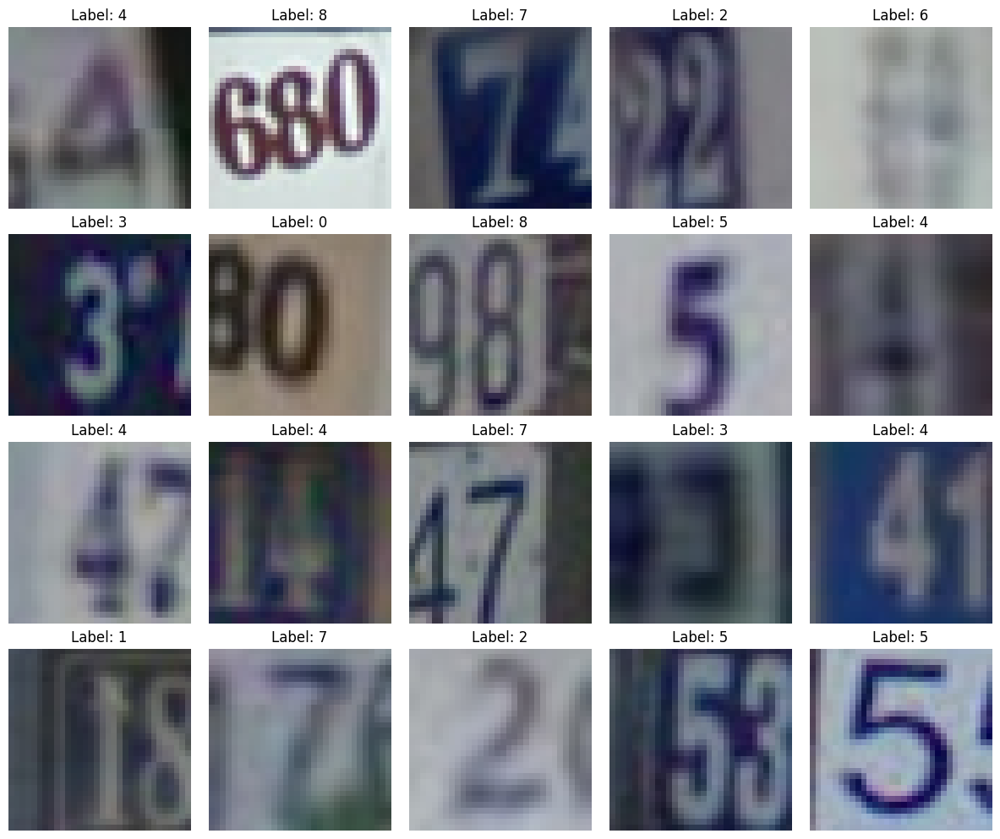
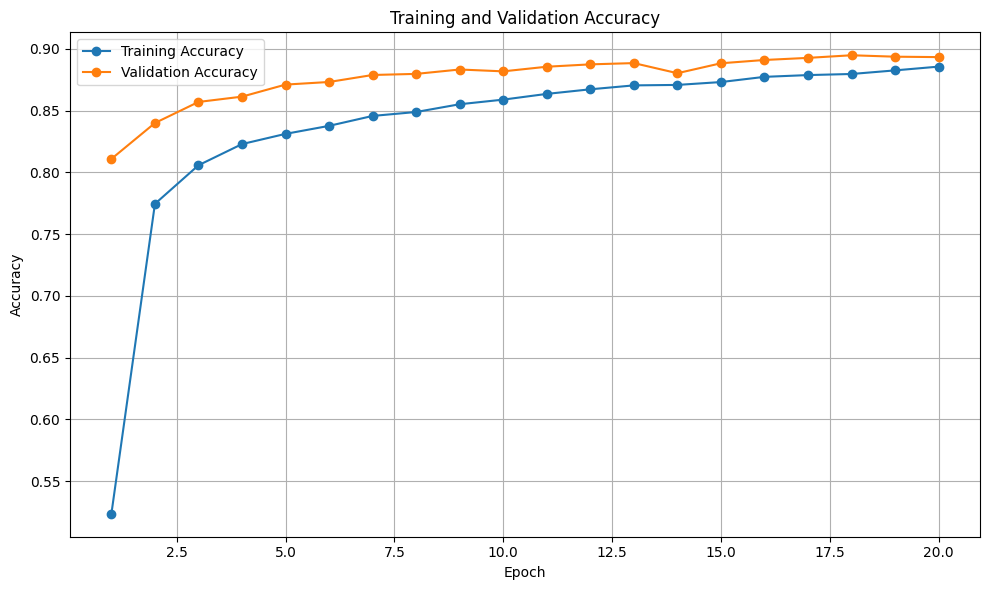
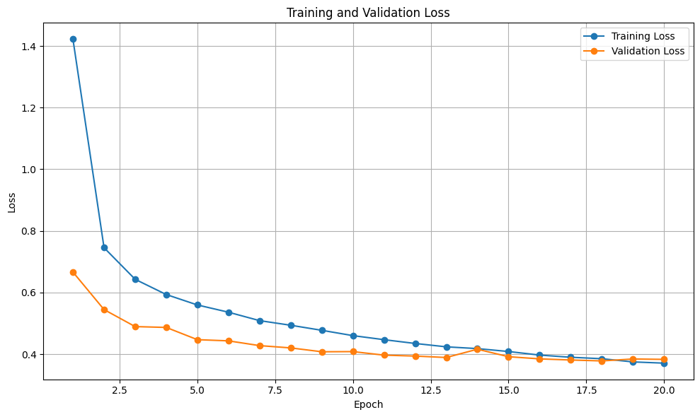
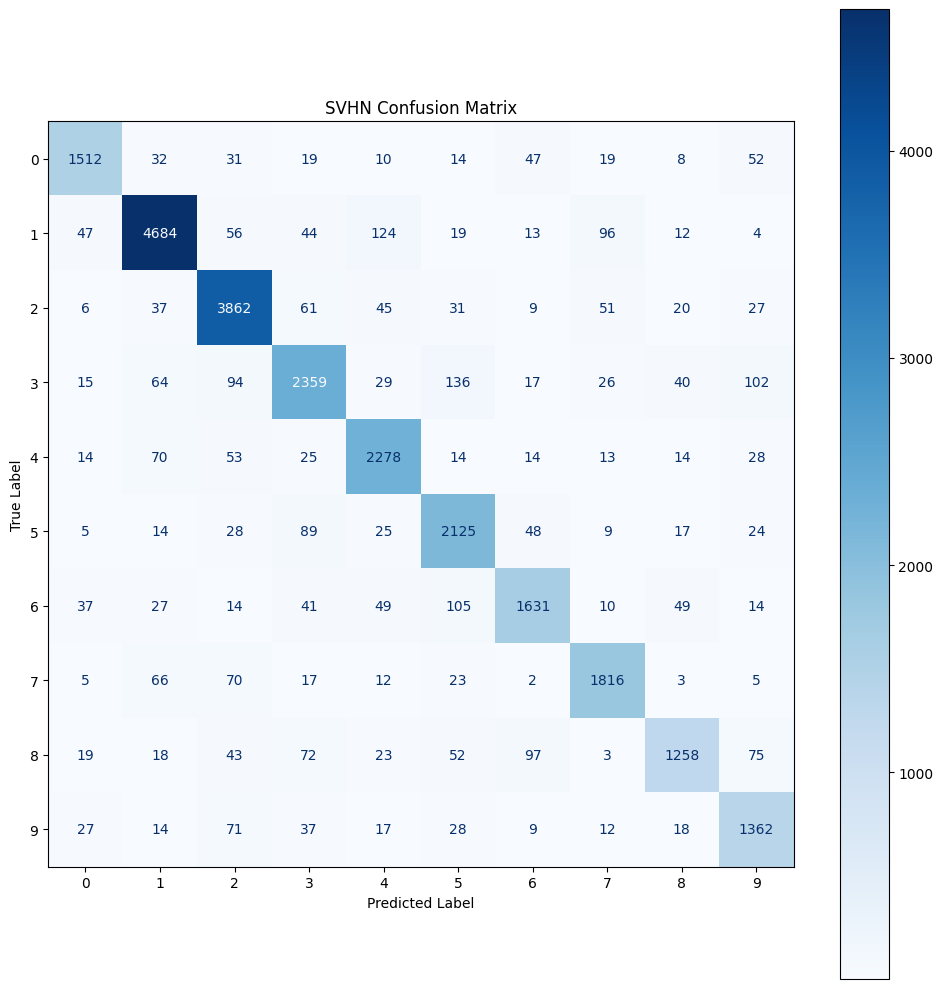
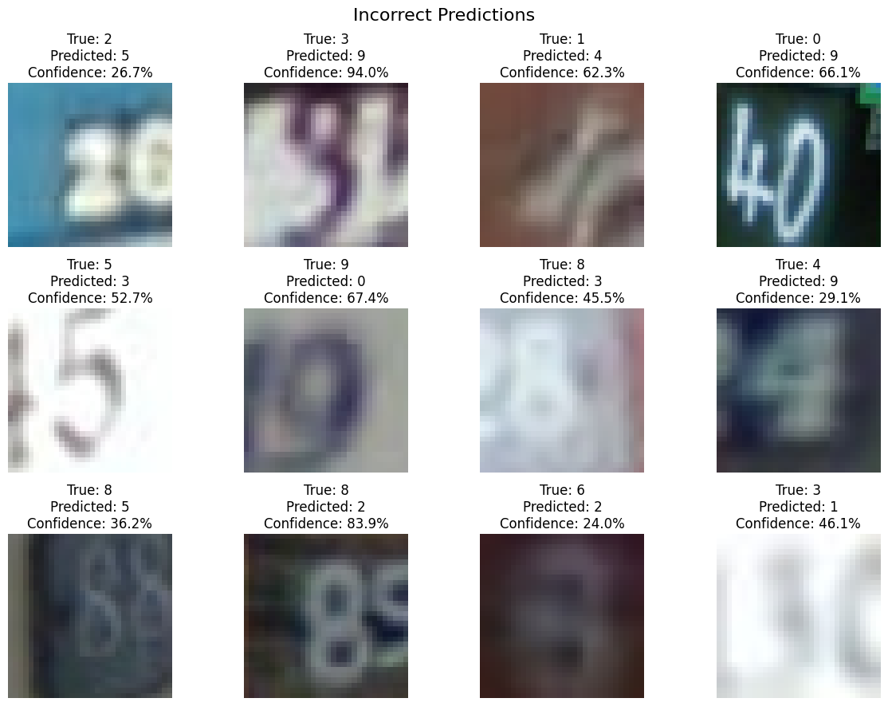

# 🏠 House Number Recognition Using CNN (SVHN)

A Convolutional Neural Network that recognizes digits (0–9) in real-world house-number images from Google Street View, built with **TensorFlow / Keras**.

[](https://colab.research.google.com/github/HaithamHD/svhn-digit-recognition/blob/main/SVHN_Final_Project.ipynb)


<p align="center">
  
</p>

## 📌 Problem

Recognizing digits in natural images is much harder than recognizing clean handwritten digits. Street-view images contain different lighting, blur, complex backgrounds, camera angles and neighboring digits. The goal of this project is to classify the main digit in each cropped 32×32 RGB image into one of **10 classes**.

## 📊 Dataset

[SVHN – Street View House Numbers](http://ufldl.stanford.edu/housenumbers/) (cropped digits), loaded with `tensorflow_datasets` as `svhn_cropped`.

| Split | Images |
|---|---|
| Training (80% of original train) | 58,606 |
| Validation (20% of original train) | 14,651 |
| Test | 26,032 |

- Image size: 32 × 32 × 3 (RGB)
- Classes: 10 (digits 0–9)

## 🧠 Model

A simple CNN with **315,722** trainable parameters:

```text
Input 32x32x3 → Rescaling (1/255)
→ Conv2D 32 + ReLU → MaxPooling
→ Conv2D 64 + ReLU → MaxPooling
→ Flatten → Dense 128 + ReLU → Dropout 0.5
→ Dense 10 + Softmax
```

- **Optimizer:** Adam (learning rate 0.001)
- **Loss:** Sparse Categorical Crossentropy
- **Training:** up to 20 epochs, batch size 64, Early Stopping on validation loss (best epoch: 18)

## 📈 Results

| Metric | Score |
|---|---|
| **Test accuracy** | **87.92%** |
| Test loss | 0.4334 |
| Macro F1-score | 0.8679 |
| Weighted F1-score | 0.8788 |

<p align="center">
  
  
</p>

<p align="center">
  
</p>

### Error analysis

<p align="center">
  
</p>

Most errors come from low image quality, weak lighting, small or partially hidden digits, neighboring digits inside the crop, and digits with similar shapes (e.g. 3/5/8/9).

## 🚀 How to Run

**Easiest:** click the **Open in Colab** badge above, then choose *Runtime → Run all* (a GPU runtime is recommended).

**Locally:**

```bash
git clone https://github.com/HaithamHD/svhn-digit-recognition.git
cd svhn-digit-recognition
pip install -r requirements.txt
jupyter notebook SVHN_Final_Project.ipynb
```

The dataset is downloaded automatically by `tensorflow_datasets` the first time the notebook runs.

## 📁 Project Structure

```text
├── SVHN_Final_Project.ipynb   # Full code with outputs
├── report/
│   └── SVHN_Final_Report.pdf  # Project report
├── images/                    # Figures used in this README
├── requirements.txt
└── README.md
```

## 👥 Team

- Abdelrahman Ahmed Alazzazi
- Haitham Hani Dalloul

**Supervisor:** Dr. Hassan S. Elhallaq
*Machine Learning Final Project – Faculty of Information Technology, Al-Aqsa University.*
